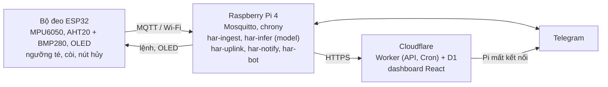
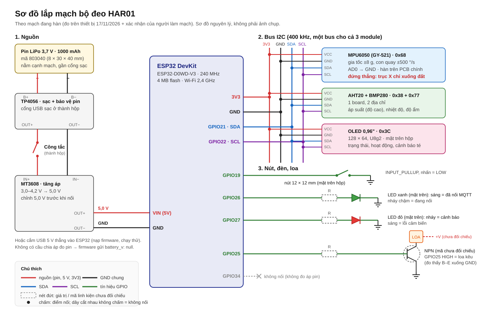
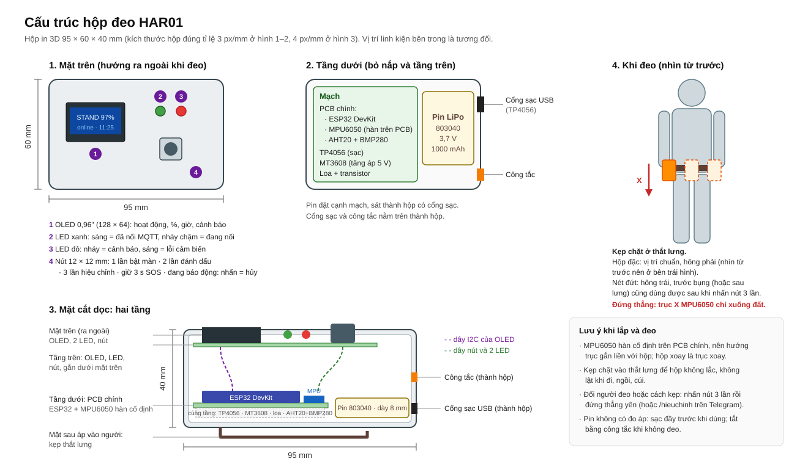

# HAR – Bộ đeo hông nhận dạng hoạt động và phát hiện té ngã

Đồ án IoT: bộ đeo hông nhận dạng 7 hoạt động và phát hiện té ngã cho người cao tuổi (prototype giám sát trong nhà).
Model chạy trên Raspberry Pi 4 (edge); kết quả, số liệu đánh giá và dashboard nằm trên cloud (Cloudflare Worker + D1, [`cloud/`](cloud/)), không xem bằng localhost.

## Kiến trúc (IoT Level 2)

Một node giám sát (bộ đeo + gateway Pi), phân tích cục bộ trên Pi, lưu trữ và ứng dụng trên cloud. Lý do chọn cấp 2: [`docs/kien-truc.md`](docs/kien-truc.md#cấp-độ-iot).

- Cấu trúc hệ thống, luồng dữ liệu, luồng cảnh báo té: [`docs/kien-truc.md`](docs/kien-truc.md).
- Phần cứng bộ đeo (sơ đồ lắp mạch, cấu trúc hộp, vị trí đeo): [`hardware/README.md`](hardware/README.md).

### Sơ đồ lắp mạch

### Cấu trúc hộp đeo

## Cấu trúc thư mục

| Thư mục | Nội dung | Trạng thái |
| --- | --- | --- |
| [`firmware/`](firmware/) | Firmware ESP32 (PlatformIO, FreeRTOS 5 task) | Chạy trên bộ đeo `har01`; 23 test native (nút, cảnh báo, hiệu chỉnh, chọn Wi-Fi) |
| [`edge/`](edge/) | Dịch vụ Pi: `har-ingest`, `har-infer`, `har-uplink`, `har-notify`, `har-bot`; `record.py`, `replay.py`, `fake_device.py`; systemd, `setup-pi.sh` | Chạy trên Pi; 45 test pytest |
| [`ml/`](ml/) | Dataset, Random Forest, 1D-CNN (TFLite int8), thí nghiệm A1/A2/B1/B2/C/D, đẩy `metrics.json` | Model v4 (RF) trên dữ liệu thật S01–S04 + SisFall, đang chạy trên Pi |
| [`cloud/`](cloud/) | **Cloud đang dùng:** Cloudflare Worker (TypeScript) + D1, phục vụ API và web app; công cụ tạo tài khoản, khóa thiết bị | Đang chạy tại `har-cloud.har-cloud.workers.dev`; 10 test đầu-cuối |
| [`backend/`](backend/) | Bản VPS dự phòng (cùng API): FastAPI + PostgreSQL + Caddy, Docker Compose, Alembic, sao lưu | 9 test pytest |
| [`webapp/`](webapp/) | React + Vite + TypeScript: Tổng quan, Cảm biến, Lịch sử, Cảnh báo, Đánh giá model | Build sạch; chạy thử với API thật |
| [`hardware/`](hardware/) | Sơ đồ lắp mạch, cấu trúc hộp đeo, datasheet số đo | Theo mạch thật |
| [`docs/`](docs/) | Cấu trúc hệ thống, hợp đồng dữ liệu (MQTT, schema, API, nhãn, bảng chân), kế hoạch, vận hành | |

Đọc [`docs/`](docs/) trước khi sửa code ở bất kỳ phần nào: đó là "hợp đồng" giữa firmware, Pi, backend và web app.

## Chạy thử toàn tuyến trên laptop (không cần phần cứng)

1. Backend: xem [`backend/README.md`](backend/README.md) (SQLite, không cần Docker) → tạo tài khoản và API key thiết bị.
2. Broker MQTT trên laptop (Mosquitto hoặc Docker `eclipse-mosquitto`).
3. Edge: `CLOUD_BACKEND=vps`, `VPS_API_URL=http://localhost:8000/api`, chạy 4 dịch vụ rồi `python fake_device.py` ([`edge/README.md`](edge/README.md)).
4. Web app: `VITE_DATA_SOURCE=api npm run dev` ([`webapp/README.md`](webapp/README.md)).

## Thứ tự triển khai thật

1. Mạch bộ đeo: [`hardware/README.md`](hardware/README.md), bảng chân [`docs/pinout.md`](docs/pinout.md). Kế hoạch và việc tiếp theo: [`docs/ke-hoach.md`](docs/ke-hoach.md).
2. Nạp firmware ([`firmware/README.md`](firmware/README.md)).
3. Cài Pi: `sudo HOTSPOT_PASS=... bash edge/deploy/setup-pi.sh` ([`edge/README.md`](edge/README.md)).
4. Deploy cloud lên Cloudflare: [`cloud/README.md`](cloud/README.md) (bản VPS dự phòng: [`backend/DEPLOY.md`](backend/DEPLOY.md)).
5. Thu dataset bằng `record.py`, huấn luyện ở `ml/`, chép model sang `edge/models/current/`, đẩy `metrics.json` lên cloud.

## Quy tắc chung

- **Không commit bí mật.** Mỗi phần có file mẫu (`.env.example`, `secrets.example.h`); copy thành file thật rồi điền. File thật đã nằm trong `.gitignore`. Repo nên để **riêng tư**.
- **Không commit dữ liệu thô hay model lớn.** Dataset để ở Google Drive của nhóm; repo chỉ chứa code và file `metrics.json` của dữ liệu thật.
- Đổi schema trong `docs/` thì tăng số phiên bản `v` trong payload và ghi lại thay đổi ở cuối file đó.
- Mỗi việc một nhánh, gộp vào `main` qua pull request.
