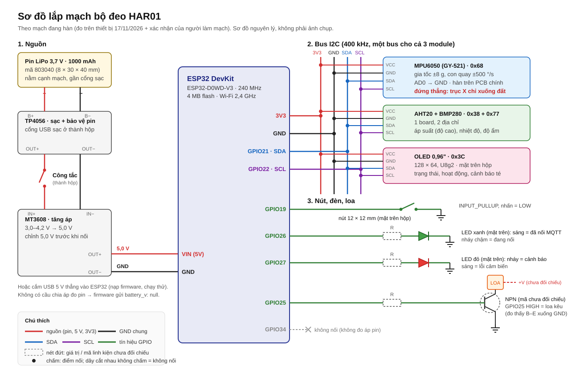
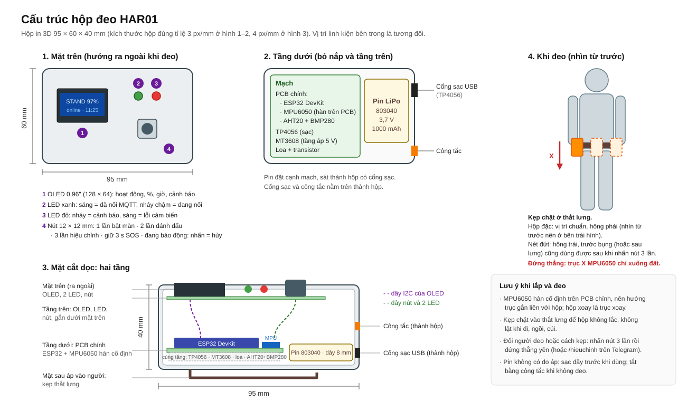

# 1. Lắp mạch và thiết kế bộ đeo

Kết quả cuối: bộ đeo `har01` trong hộp in 3D 95 × 60 × 40 mm, kẹp thắt lưng ở hông phải. Sơ đồ mạch, bố trí hộp và bảng nối dây đầy đủ: [`../../hardware/README.md`](../../hardware/README.md).

## 1.1. Yêu cầu thiết kế

Các yêu cầu đã quyết định cách chọn linh kiện và bố trí hộp:

| Yêu cầu | Hệ quả |
| --- | --- |
| Đeo ở hông, nhận dạng 7 hoạt động và té | MPU6050 (gia tốc + con quay) **gắn cứng** vào hộp; hộp kẹp chặt, không lắc |
| Phân biệt đi bộ với lên/xuống cầu thang | Cảm biến áp suất BMP280 (đổi ra độ cao) |
| Người đeo tự hủy báo nhầm | Nút nhấn và còi ngay trên bộ đeo |
| Người đeo xem trạng thái | OLED 0,96" và 2 LED ở mặt ngoài |
| Đeo cả ngày, không dây | Pin LiPo + mạch sạc + tăng áp 5 V, công tắc |
| Gửi dữ liệu liên tục 50 Hz | ESP32 (Wi-Fi 2,4 GHz) |

## 1.2. Linh kiện và dụng cụ

| Linh kiện | SL | Ghi chú |
| --- | --- | --- |
| ESP32 DevKit (ESP32-D0WD-V3, USB CP210x) | 1 | |
| MPU6050 (GY-521) | 1 | I2C 0x68, AD0 nối GND |
| Board AHT20 + BMP280 | 1 | I2C 0x38 + 0x77 |
| OLED 0,96" 128 × 64 (SSD1306/SSD1315) | 1 | I2C 0x3C |
| Nút nhấn 12 × 12 mm | 1 | |
| LED xanh, LED đỏ + điện trở hạn dòng | 2 | |
| Loa/còi chủ động + transistor NPN + điện trở chân B | 1 | |
| Pin LiPo 3,7 V 1000 mAh (803040) | 1 | |
| TP4056 (có mạch bảo vệ) | 1 | Sạc + chống xả sâu |
| MT3608 | 1 | Tăng áp lên 5,0 V |
| Công tắc | 1 | |
| PCB đục lỗ, dây silicone mềm, thiếc có nhựa thông, ống co nhiệt, băng keo cách điện | | |
| Hộp in 3D 95 × 60 × 40 mm, kẹp thắt lưng | 1 | |

Dụng cụ: mỏ hàn chỉnh nhiệt, đồng hồ vạn năng (bắt buộc, để chỉnh MT3608 và đo chập), breadboard + dây cắm để thử trước.

## 1.3. Bảng chân (theo mạch đang hàn)

| Chức năng | Chân ESP32 |
| --- | --- |
| I2C SDA / SCL (cả 3 module) | GPIO21 / GPIO22 |
| Nút → GND | GPIO19 (`INPUT_PULLUP`, nhấn = LOW) |
| LED xanh / LED đỏ | GPIO26 / GPIO27 (HIGH = sáng) |
| Loa qua transistor | GPIO25 (HIGH = kêu) |
| Đo áp pin | Không có (GPIO34 bỏ trống) |

Nếu làm mạch mới mà muốn đổi chân, sửa `firmware/include/pins.h` và [`../pinout.md`](../pinout.md) **cùng lúc**.

## 1.4. Thứ tự lắp

### Bước 1. Thử từng khối trên breadboard

Thêm một khối, thử đạt rồi mới thêm khối sau; có lỗi thì biết ngay khối nào.

1. ESP32 cắm USB, nạp chương trình trống, Serial chạy.
2. Thêm bus I2C với MPU6050 → quét I2C thấy `0x68`.
3. Thêm board AHT20 + BMP280 → thấy `0x38 0x68 0x77`.
4. Thêm OLED → thấy `0x38 0x3C 0x68 0x77`.
5. Thêm nút, 2 LED, loa + transistor → thử bằng chương trình bật/tắt chân.
6. Cuối cùng mới thêm khối nguồn pin (bước 2).

### Bước 2. Chỉnh MT3608 trước khi nối ESP32

Module MT3608 mới có thể xuất xưởng ở mức áp cao hơn 5 V và làm hỏng ESP32.

1. Cấp pin (qua TP4056) vào IN+, IN−, **để trống đầu ra**.
2. Đo OUT+ / OUT− bằng đồng hồ, vặn biến trở tới đúng **5,0 V**.
3. Chỉ sau đó mới nối OUT+ → VIN (5V), OUT− → GND của ESP32.

Đường nguồn: pin → TP4056 (B+/B−) → OUT+ → công tắc → MT3608 IN+ → OUT+ → VIN. Lấy nguồn ở OUT của TP4056, không lấy ở B+, để đi qua mạch bảo vệ pin.

### Bước 3. Hàn

- Hàn linh kiện thấp trước, cao sau. Không hàn trực tiếp lên thân pin.
- Dây silicone mềm cho các đoạn ra ngoài PCB (OLED, nút, LED lên mặt trên hộp); bọc ống co nhiệt mọi mối nối dây.
- MPU6050 hàn **cố định trên PCB chính**: hướng trục MPU6050 gắn liền với hộp. Ghi lại trục nào chỉ xuống đất khi đeo đứng thẳng (mạch hiện tại: **trục X chỉ xuống**).
- Board AHT20 + BMP280 đặt xa ESP32 và MT3608 nếu được (xem sự cố "AHT20 đọc nóng" ở dưới).

### Bước 4. Kiểm tra trước khi cấp nguồn lần đầu

- Đồng hồ thang thông mạch: 5V–GND, 3V3–GND **không** được kêu (không chập).
- Đúng cực pin trên TP4056, đúng cực LED.
- Cấp nguồn bằng USB trước (không bật công tắc pin), sờ thử không có linh kiện nóng bất thường.

### Bước 5. Dò lại mạch sau khi hàn (bắt buộc)

**Bài học lớn nhất của nhóm:** mạch hàn xong khác bản thiết kế ở vài chỗ mà không ai ghi lại. Trước khi nạp firmware chính:

1. **Quét I2C**: phải thấy đúng 4 địa chỉ `0x38 0x3C 0x68 0x77`. Firmware HAR tự in dòng này lúc khởi động (`[i2c] bus1 SDA21/SCL22: ...`).
2. **Dò chân nút**: bật kéo lên cho mọi GPIO trống, in chân nào xuống LOW khi nhấn.
3. **Xác định hướng trục**: đặt hộp đúng tư thế đeo khi đứng, xem trục nào ≈ −1 g.
4. Ghi kết quả vào `pins.h`, `docs/pinout.md`, `hardware/README.md`.

### Bước 6. Xếp vào hộp

- Hai tầng: mặt trên có OLED, 2 LED, nút; tầng dưới có PCB chính (ESP32 + MPU6050), AHT20 + BMP280, TP4056, MT3608, loa.
- Pin đặt cạnh mạch, sát thành hộp có cổng sạc. Cổng sạc USB của TP4056 và công tắc lộ ra thành hộp.
- Dán băng keo cách điện giữa pin và mặt dưới PCB. Chèn xốp để pin không xê dịch khi té.
- Mặt sau gắn kẹp thắt lưng.

### Bước 7. Cách đeo

- Kẹp chặt vào thắt lưng ở hông phải, mặt có màn hình hướng ra ngoài.
- Đứng thẳng thì trục X của MPU6050 chỉ xuống đất (ax ≈ −1 g).
- Đổi người đeo hoặc cách kẹp: nhấn nút 3 lần rồi đứng thẳng yên ~2 s (bíp dài = đạt), hoặc `/hieuchinh` trên Telegram.

## 1.5. Kiểm tra sau khi lắp

| Phép thử | Đạt khi |
| --- | --- |
| Quét I2C | Đủ `0x38 0x3C 0x68 0x77`, MPU6050 `WHO_AM_I = 0x68`, BMP280 `chip_id = 0x58` |
| Đặt yên trên bàn | Gia tốc ≈ 1 g (thực tế đo 0,94 g, xem dưới), con quay sau hiệu chỉnh ≈ 0 |
| Nút | Firmware in `[btn] 1-lần`, `nhấn-đúp`, `giữ-3s` |
| Loa, LED | `{"cmd":"beep","ms":300}` kêu; LED xanh sáng khi có MQTT |
| Thả hộp lên nệm | Còi kêu ngắt quãng, nhấn nút thì hủy |
| Rút USB, chạy pin | ESP32 không tự khởi động lại khi còi kêu (sụt áp) |

## Sự cố đã gặp

Chi tiết từng mục: [`../firmware-integration.md`](../firmware-integration.md).

| Sự cố | Nguyên nhân | Xử lý | Mục |
| --- | --- | --- | --- |
| Nhấn nút không hủy được cảnh báo té | Nút hàn vào **GPIO19**, firmware đọc GPIO32 theo thiết kế | Dò chân bằng chương trình tạm, sửa `PIN_BUTTON 19` (không đổi dây) | 11 |
| Nhận dạng sai, máy báo "đã đổi tư thế" khi đứng | MPU6050 hàn xoay 90°: **trục X** chỉ xuống chứ không phải Y | Code theo phần cứng: `UPRIGHT = [-1, 0, 0]` | 13 |
| OLED hiện hình cũ, không phải màn HAR | OLED cắm chung bus I2C GPIO21/22, firmware vẽ ra bus 2 | `OLED_I2C_BUS 1`; màn gửi từng dải nhỏ để không chiếm bus của MPU6050 | 2 |
| Pi báo pin yếu sai, OLED luôn "USB" | Mạch **không có cầu chia áp** vào GPIO34 | Firmware gửi `battery_v: null`, OLED hiện giờ | 4 |
| Con quay lệch +13,7 °/s khi nằm yên | Sai số riêng của MPU6050 | Tự hiệu chỉnh 1,5 s nằm yên sau khi bật (`lib/gyro_cal`). **Bật xong đặt yên ~2 s rồi mới đeo** | 5 |
| AHT20 đọc 43 °C sau 1 giờ | Board bị hâm nóng bởi ESP32 và mạch nguồn | Không dùng nhiệt độ làm đặc trưng; làm lại nên đặt xa nguồn nhiệt, có lỗ thông khí | 10 |
| Gia tốc nằm yên 0,94 g thay vì 1 g | Sai số offset/tỉ lệ của gia tốc kế | Chấp nhận (ảnh hưởng nhỏ); tùy chọn hiệu chỉnh 6 mặt | 10 |
| Dữ liệu té có dao động giả 2 Hz | Còi rung cơ học cả hộp, gia tốc kế bắt được | Khi thu dataset còi không kêu, chỉ LED + OLED. Làm lại nên đặt loa xa MPU6050, đệm cao su | 16 |

**Rủi ro còn lại:**
- Chưa đo thời lượng pin, chưa đo dòng tiêu thụ, chưa thử chạy pin lâu. Không có cảnh báo pin yếu: sạc đầy trước khi dùng.
- Chưa ghi mã transistor loa, giá trị điện trở LED và điện trở chân B.
- Bản thiết kế ban đầu (`hardware/So_do_lap_bo_deo_HAR.html`) khác mạch thật ở pin, hộp, chân nút, hướng MPU6050; đừng lắp theo bản đó mà không đối chiếu bảng "Khác bản thiết kế" trong [`../../hardware/README.md`](../../hardware/README.md#khác-bản-thiết-kế-ban-đầu).
