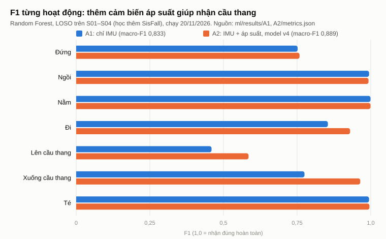
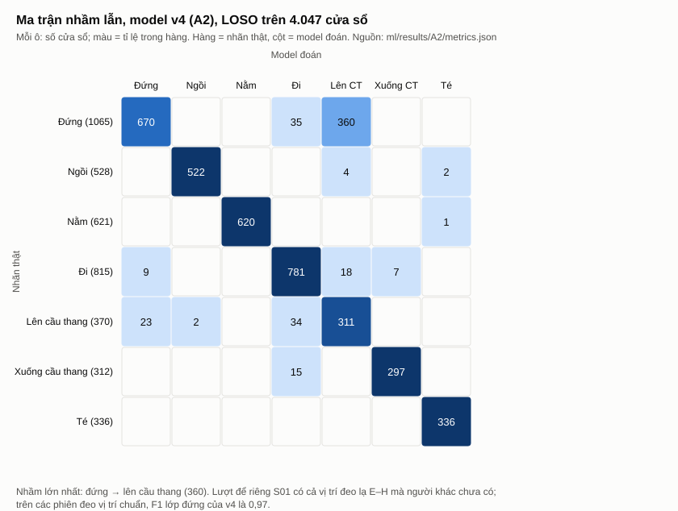

# 6. Chuẩn bị bảo vệ: 5 nhóm câu hỏi

Câu trả lời ngắn để cả nhóm nói giống nhau, kèm số liệu thật và nơi lấy số liệu. Số đo lấy từ hệ thống đang chạy (đến 21/11/2026); chỗ nào **chưa làm hoặc chưa đo** thì ghi rõ, đừng nói quá lên khi bảo vệ.

## 1. Kiến trúc và cấp độ IoT

### Hệ thống ở cấp mấy, vì sao?

**Cấp 5** theo Bahga & Madisetti: có nút cuối (bộ đeo) đo và chấp hành, một **nút điều phối** (Raspberry Pi) gom dữ liệu rồi gửi lên cloud; dữ liệu lưu trên cloud, ứng dụng chạy trên cloud.

| Cấp | Đặc điểm | Hệ thống HAR |
| --- | --- | --- |
| 1–3 | Một nút, không có nút điều phối | Không: bộ đeo không gửi thẳng lên cloud |
| 4 | Nhiều nút, phân tích cục bộ, lưu cloud, không có nút điều phối riêng | Gần, nhưng HAR có Pi làm điều phối |
| **5** | **Nút cuối + nút điều phối + lưu trữ và ứng dụng trên cloud** | **Đúng cấu trúc HAR** |
| 6 | Nhiều nút độc lập gửi thẳng lên cloud, có bộ điều khiển tập trung | Không |

**Vì sao chọn cấu trúc này:**
- Bộ đeo chạy pin, ESP32 không đủ sức chạy model liên tục; Pi chạy Random Forest ~28 ms mỗi cửa sổ.
- Cảnh báo té phải nhanh và chạy được khi mất Internet: bộ đeo tự kêu còi, Pi vẫn chạy model, báo Telegram, giữ dữ liệu chờ gửi.
- Người thân ở xa cần xem qua Internet: dashboard và kết quả nằm trên Cloudflare.

**Nếu bị hỏi vặn** "phân tích chạy trên Pi chứ không trên cloud, sao không phải cấp 4?": cấp 5 khác cấp 4 ở **nút điều phối**. HAR có Pi làm điều phối: broker MQTT, máy chủ giờ, gom dữ liệu và chuyển lên cloud. Phân tích chính đặt ở điều phối (edge) vì độ trễ và để chạy khi mất mạng. Cloud vẫn có phân tích tổng hợp: tổng hợp theo ngày, so sánh 7 ngày, số liệu đánh giá model, phát hiện Pi mất kết nối.

### Các thành phần ứng với thiết bị nào?

| Thành phần (Bahga & Madisetti) | Trong HAR |
| --- | --- |
| **Device** (nút cuối) | Bộ đeo `har01`: ESP32 + cảm biến + còi |
| **Resource** (đọc cảm biến, điều khiển chấp hành) | MPU6050, AHT20 + BMP280, nút, OLED, 2 LED, còi; driver trong `firmware/src/sensors.cpp`, `ui.cpp`, `display.cpp` |
| **Controller service** (đẩy dữ liệu lên, nhận lệnh xuống) | Trên bộ đeo: `netTask` (`net.cpp`) gửi MQTT, nhận lệnh `har/har01/cmd`. Trên Pi: `har-ingest`, `har-uplink` chuyển dữ liệu lên cloud |
| **Gateway / Coordinator** | Raspberry Pi 4: Mosquitto (broker), chrony (giờ), các dịch vụ HAR |
| **Database** | Trên Pi: SQLite `edge.db` + CSV dữ liệu thô. Trên cloud: D1 `har-db` |
| **Web service** | Cloudflare Worker `har-cloud`: REST API `/api/*` |
| **Analysis** | Pi: `har-infer` (model v4, hợp nhất cảnh báo té). Cloud: tổng hợp ngày, Cron kiểm tra Pi |
| **Application** | Dashboard React (4 trang) + bot Telegram |
| **Cloud** | Cloudflare (Worker + D1 + phục vụ web app) |

Sơ đồ: [`../kien-truc.md`](../kien-truc.md).

## 2. Cảm biến và cơ cấu chấp hành

### Cảm biến

| | MPU6050 | BMP280 | AHT20 |
| --- | --- | --- | --- |
| Đo | Gia tốc 3 trục + vận tốc góc 3 trục | Áp suất khí quyển (→ độ cao) | Nhiệt độ, độ ẩm |
| Nguyên lý | MEMS. Gia tốc kế: khối thử treo trên lò xo silicon, gia tốc làm khối lệch, đo bằng thay đổi **điện dung**. Con quay: khối dao động, quay sinh **lực Coriolis** vuông góc, đo bằng điện dung | Màng silicon **áp trở**: áp suất làm màng cong, điện trở đổi | Độ ẩm: tụ điện có điện môi **hút ẩm**; nhiệt độ: cảm biến bán dẫn |
| Dải đo (cấu hình đang dùng) | ±8 g (4096 LSB/g), ±500 °/s (65,5 LSB/(°/s)), ADC 16 bit, lọc thông thấp 21 Hz | 300–1100 hPa | 0–100 %RH, −40–85 °C |
| Sai số theo datasheet | Lệch 0 g ±50 mg (X, Y), độ nhạy ±3 %; con quay lệch 0 ±20 °/s | Tuyệt đối ±1 hPa; tương đối ±0,12 hPa (≈ ±1 m) | ±2 %RH, ±0,3 °C |
| **Đo trên mạch thật** | Nằm yên 0,942 g thay vì 1 g (−5,8 %); con quay lệch **+13,7 °/s** → sau tự hiệu chỉnh còn 0,08 °/s | Dao động ±2,8 Pa (≈ ±0,25 m), đúng 10 Hz | Bị hâm nóng: 31 °C lúc bật → 43 °C sau 1 giờ |
| Tần số lấy mẫu | 50 Hz | 10 Hz | Mỗi 10 s |
| Dùng để | Đầu vào chính của model và ngưỡng té | Phân biệt đi bộ với cầu thang (1 m ≈ 12 Pa) | Chỉ hiển thị, **không dùng** làm đặc trưng (đọc sai do nóng) |

Cả 3 module (và OLED) dùng chung **một bus I2C**: SDA GPIO21, SCL GPIO22, 400 kHz; địa chỉ 0x68 (MPU6050), 0x38 + 0x77 (AHT20 + BMP280), 0x3C (OLED).

### Cơ cấu chấp hành và giao diện

| | Chân | Cách nối | Khi nào hoạt động |
| --- | --- | --- | --- |
| Còi (chủ động) | GPIO25 | Qua transistor NPN (ESP32 không cấp đủ dòng trực tiếp); HIGH = kêu | Nghi té: kêu ngắt quãng 10 s chờ hủy → xác nhận: kêu liên tục 30 s; lệnh `/coi` |
| LED xanh | GPIO26 | Điện trở hạn dòng → LED → GND | Sáng: đã nối MQTT; nháy: đang nối |
| LED đỏ | GPIO27 | Như trên | Nháy nhanh: báo động; sáng: lỗi MPU6050 |
| OLED 0,96" | I2C 0x3C | Chung bus | Hoạt động, độ tin cậy, giờ, cảnh báo té |
| Nút (đầu vào) | GPIO19 | Nút → GND, điện trở kéo lên trong chip | Hủy cảnh báo, SOS, hiệu chỉnh |

Bảng chân đầy đủ: [`../pinout.md`](../pinout.md), sơ đồ mạch: [`../../hardware/README.md`](../../hardware/README.md).

### Ngưỡng kích hoạt lấy từ đâu?

| Ngưỡng | Giá trị | Nguồn gốc |
| --- | --- | --- |
| Té trên bộ đeo: rơi tự do | SVM < 0,6 g trong ≥ 60 ms | Khởi điểm 0,4 g / 80 ms theo dạng tín hiệu té điển hình (rơi → va chạm → nằm yên). **Chỉnh theo cú té thật** của nhóm: cú ngã 3,5 g bị bỏ lọt vì hộp ở hông rơi tự do chỉ ~40 ms |
| Té: va chạm | > 2,5 g trong 0,5 s sau rơi | Như trên; té thật đo được 3,1–12 g |
| Té: bất động + đổi tư thế | Yên ở giây 2–3 sau va chạm, nghiêng > 50° so với hướng đứng | Ban đầu xét giây 1–2, nhưng người còn nảy trên nệm; dữ liệu thật cho thấy từ giây 1,5 mới yên |
| Thời gian chờ hủy | 10 s | Đủ để người đeo nhận ra và nhấn nút; té → Telegram vẫn < 15 s |
| Model tự báo té | P(té) ≥ 0,5 và không phải đang nằm | Chọn trên 23 cú té S01 + 2.626 phiên sinh hoạt SisFall: 0,8 không bắt được cú nào; 0,5 bắt 22/23. Điều kiện "không đang nằm" bỏ báo giả khi trở mình |
| Chặn nhãn cầu thang | Độ cao 10 s đổi < 0,3 m | Phân bố thật: đứng/đi 0,09–0,11 m, cầu thang 1,5–1,7 m |
| Bộ đeo mất kết nối / Pi mất kết nối | 2 phút / 10 phút | Tránh báo nhầm khi Wi-Fi chập chờn hay Pi khởi động lại |

Kiểm chứng ngưỡng: thí nghiệm D. Ngưỡng bộ đeo bắt 18/23 cú té, model 23/23, kết hợp 23/23; 0 báo giả trên 1,46 giờ phiên sinh hoạt có nhãn. Chi tiết: [`../firmware-integration.md`](../firmware-integration.md) mục 15, 19, 21.

## 3. Firmware và giao thức

### I2C hoạt động thế nào?

- Bus 2 dây: **SDA** (dữ liệu) và **SCL** (xung nhịp), cực máng hở, có điện trở kéo lên trên module.
- ESP32 là **master** tạo xung nhịp 400 kHz; mỗi cảm biến là **slave** có địa chỉ 7 bit riêng.
- Một lần đọc: START → địa chỉ + bit ghi → số thanh ghi → START lặp → địa chỉ + bit đọc → các byte dữ liệu (mỗi byte có ACK) → STOP. MPU6050 đọc 14 byte liền một lần (gia tốc, nhiệt, con quay).
- 4 thiết bị chung bus nên firmware dùng **khóa (mutex)**: task lấy mẫu MPU6050 ưu tiên cao nhất, chờ khóa tối đa 8 ms. OLED gửi màn hình theo từng dải 128 byte (~3 ms) thay vì cả khung 1 KB (~25 ms), để không làm lỡ nhịp 50 Hz.

### MQTT hoạt động thế nào?

- Mô hình **publish/subscribe** qua **broker** (Mosquitto trên Pi, TCP cổng 1883, bắt buộc tài khoản). Bên gửi và bên nhận không biết nhau, chỉ biết **topic**.
- Bộ đeo publish `har/har01/imu` (25 mẫu/0,5 s), `env`, `event`, `status`; subscribe `har/har01/cmd`, `display`, `ack`. Danh sách: [`../mqtt.md`](../mqtt.md).
- **QoS 0** cho dữ liệu cảm biến (mất một gói không sao, `seq` để đếm gói mất); **QoS 1** cho lệnh từ Pi.
- **Retained** cho `status`: ai subscribe sau vẫn nhận trạng thái cuối. **Last Will**: bộ đeo mất kết nối đột ngột thì broker tự phát `{"online":false}`.
- **Keepalive** 15 s.
- Sự kiện té **không được mất**: thư viện PubSubClient chỉ publish QoS 0, nên tầng ứng dụng tự đảm bảo. Bộ đeo lưu sự kiện vào flash (LittleFS), gửi lại mỗi 5 s tới khi Pi trả `ack` cùng `id`. Pi và cloud chống trùng theo `id`.
- Mất mạng: bộ đeo giữ 60 s dữ liệu (120 gói) và gửi bù khi có mạng lại.

### Độ trễ (đo trên hệ thống thật)

| Chặng | Trung vị | Chậm nhất / p95 |
| --- | --- | --- |
| Bộ đeo → Pi (MQTT) | 18 ms | p95 28 ms |
| Mẫu cuối → kết quả model trên Pi | 71 ms | p95 139 ms |
| Pi → cloud (HTTPS) | ~0,6 s | chậm nhất 1,9 s |
| Đổi hoạt động → dashboard đổi | ~2 s sau khi Pi gửi | |
| Té → Telegram | ~13 s (bộ đeo tự phát hiện), ~19 s (chỉ model phát hiện) | đã gồm 10 s chờ hủy |
| Mất gói MQTT theo ngày | 0–0,12 % | |
| Truyền liên tục 30 phút | 50,000 Hz, mất 0 gói | |

### Chạy qua Internet được chưa?

| Chặng | Qua Internet? |
| --- | --- |
| Bộ đeo ↔ Pi | **Không, chủ ý chỉ trong mạng nội bộ.** Không mở MQTT ra Internet (an toàn, Pi xử lý tại chỗ, chạy được khi mất mạng). Muốn bộ đeo ở xa Pi thì cần MQTT qua TLS (cổng 8883) tới broker công khai hoặc VPN: chưa làm |
| Pi → cloud | **Có**: HTTPS tới Cloudflare, khóa thiết bị riêng |
| Người xem → dashboard | **Có**: `https://har-cloud.har-cloud.workers.dev`, đăng nhập, xem từ bất kỳ đâu. Kế hoạch demo mở bằng 4G trên máy chiếu (chưa thử) |
| Telegram | **Có**: cảnh báo và lệnh qua Internet |
| Pi mất Internet | Bộ đeo vẫn kêu còi khi té, Pi vẫn chạy model và lưu dữ liệu chờ gửi; Telegram và dashboard ngừng tới khi có mạng; cloud báo "Pi mất kết nối" sau 10 phút |

## 4. Dữ liệu và mô hình AI

### Bao nhiêu mẫu, dữ liệu thật hay lấy trên mạng?

**Cả hai.** Dữ liệu tự thu bằng chính bộ đeo `har01` là chính; SisFall (dataset công bố) bổ sung té vì chỉ một người trong nhóm té thử được.

| Bộ dữ liệu | Nguồn | Quy mô | Dùng để |
| --- | --- | --- | --- |
| Tự thu S01–S04 | Thật, 4 người, 17–20/11/2026 | 160 phiên, 92,5 phút ≈ **277.500 mẫu IMU** (50 Hz) + 55.500 mẫu áp suất; 23 cú té (S01, té lên nệm) | Huấn luyện + đánh giá LOSO |
| Thử T01 | Thật, 1 người ở 4 vị trí đeo | 41 phiên, 20,9 phút | **Chỉ chấm điểm**, không bao giờ huấn luyện |
| SisFall | Trên mạng (Sucerquia và cộng sự, Sensors 2017) | 38 người, 4.500 phiên: 1.798 té, 2.702 sinh hoạt; 200 Hz → hạ xuống 50 Hz | Học thêm té và đi bộ; đo báo động giả |

Sau khi cắt cửa sổ 2,5 s chồng 50 %: **4.047 cửa sổ tự thu** + 34.416 cửa sổ SisFall. Mô tả đầy đủ: [`../../ml/data/README.md`](../../ml/data/README.md); dữ liệu thô ở Google Drive của nhóm.

### Train ở đâu, model gì?

- **Huấn luyện trên laptop** (CPU, Python, scikit-learn; CNN bằng TensorFlow/Keras), **suy luận trên Pi**.
- Model đang chạy: **v4, Random Forest** 200 cây, đặc trưng IMU + áp suất, cửa sổ 2,5 s trượt mỗi 1 s. Tín hiệu được xoay về hướng đứng của từng người đeo, tách thành phần thẳng đứng/nằm ngang để không phụ thuộc cách đeo.
- Đặc trưng quan trọng nhất: độ cao thay đổi, gia tốc thẳng đứng trung bình, tốc độ đổi áp suất, góc nghiêng.
- Chọn RF thay CNN: nhẹ (~28 ms/cửa sổ trên Pi), giải thích được bằng độ quan trọng đặc trưng, điểm tương đương CNN.
- Đánh giá **leave-one-subject-out**: để riêng một người làm tập kiểm tra, không bao giờ chia ngẫu nhiên theo cửa sổ (tránh điểm ảo).

### Có biểu đồ đánh giá không?

Có: trang **Đánh giá model** trên dashboard (F1 từng lớp có/không áp suất, ma trận nhầm lẫn, thí nghiệm D, độ trễ từng chặng), và 2 biểu đồ dưới đây vẽ từ `ml/results/*/metrics.json` trong repo.

| Hoạt động | A1: chỉ IMU | A2: IMU + áp suất (v4) |
| --- | --- | --- |
| Đứng | 0,752 | 0,758 |
| Ngồi | 0,994 | 0,992 |
| Nằm | 0,999 | 0,999 |
| Đi | 0,855 | 0,930 |
| Lên cầu thang | 0,459 | 0,585 |
| Xuống cầu thang | 0,775 | 0,964 |
| Té | 0,994 | 0,996 |
| **Macro-F1** | **0,833** | **0,889** |

### Kết quả chính

| Chỉ số | Mục tiêu | Đạt |
| --- | --- | --- |
| Macro-F1 (LOSO, phiên gốc S01–S04) | ≥ 0,85 | **0,963** (v1 0,910) |
| Dữ liệu thử T01, 4 vị trí đeo | | **95 %** (v1 82 %; đứng 25 % → 99 %) |
| Độ nhạy té | ≥ 95 % | **23/23** (ngưỡng bộ đeo 18/23, model 23/23) |
| Báo giả trên sinh hoạt SisFall | | 21/2.626 phiên (0,8 %) |
| Báo động giả khi đeo sinh hoạt ≥ 2 giờ | ≤ 0,5/giờ | **Chưa đo** |

**Hạn chế phải tự nói ra trước khi bị hỏi:** chỉ 4 người tự thu; té chỉ của 1 người; T01 và S01 là cùng một người nên 95 % ở vị trí lạ chưa chứng minh cho người khác; macro-F1 LOSO in ra của v4 là 0,889 (thấp hơn 0,963) vì lượt để riêng S01 có cả vị trí đeo lạ E–H mà người khác chưa có.

## 5. Phân công và demo

Đề xuất chia 4 người theo 3 tầng hệ thống + dữ liệu. Thay "Thành viên 1–4" bằng tên thật. Mỗi người **trình bày phần mình** và trả lời câu hỏi thuộc phần đó; ai cũng nên nói được câu 1 (kiến trúc).

| Người | Phụ trách | Đã làm (theo repo) | Trả lời nhóm câu hỏi |
| --- | --- | --- | --- |
| **Thành viên 1: Phần cứng & firmware** | Bộ đeo | Chọn linh kiện, lắp mạch, hộp in 3D, dò chân và hướng trục; firmware ESP32 FreeRTOS: lấy mẫu 50 Hz, phát hiện té bằng ngưỡng, còi, nút, OLED, vòng đệm, MQTT | 2 (cảm biến, chấp hành, ngưỡng bộ đeo), 3 (I2C, firmware) |
| **Thành viên 2: Edge (Pi) & cảnh báo** | Raspberry Pi | Cài Pi, Mosquitto, chrony, tường lửa; `har-ingest`, `har-infer` (hợp nhất cảnh báo té, model nhờ bộ đeo kêu còi), bot Telegram; đo độ trễ, mất gói | 3 (MQTT, độ trễ, mất mạng), 1 (vai trò gateway) |
| **Thành viên 3: Dữ liệu & AI** | `ml/` | Kịch bản thu, thu dữ liệu S01–S04 và T01, nhập SisFall, đặc trưng, huấn luyện RF/CNN, thí nghiệm A1–D, đánh giá LOSO và T01 | 4 (toàn bộ), 2 (ngưỡng model, chặn cầu thang) |
| **Thành viên 4: Cloud, dashboard & tổng hợp** | `cloud/`, `webapp/`, báo cáo | Cloudflare Worker + D1, web app 4 trang, cảnh báo Pi mất kết nối, tài khoản; tổng hợp báo cáo, điều phối demo | 1 (cấp độ IoT, cloud), 3 (qua Internet) |

Phần **thu dữ liệu** cần cả nhóm (4 người đeo S01–S04). Thành viên 3 điều phối thu, nhưng ai cũng là người đeo.

### Kịch bản demo (~5 phút)

| Thời gian | Ai | Việc |
| --- | --- | --- |
| 0:00–0:45 | Thành viên 4 | Giới thiệu bài toán, sơ đồ 3 tầng, cấp độ IoT; mở dashboard **bằng 4G** để chứng minh là cloud |
| 0:45–1:30 | Thành viên 1 | Giới thiệu bộ đeo: cảm biến, nút, còi, OLED; đeo lên hông, nhấn 3 lần hiệu chỉnh |
| 1:30–2:30 | Thành viên 3 | Người đeo đứng, ngồi, đi, nằm: dashboard và OLED đổi theo trong ~2 s; giải thích model, mở trang Đánh giá model (F1, ma trận nhầm lẫn) |
| 2:30–3:45 | Thành viên 2 | Té lên nệm, **nhấn hủy**: không có Telegram. Té lần hai **không hủy**: còi kêu, Telegram tới, hộp đỏ giữa dashboard, bấm "Đã xử lý" |
| 3:45–4:30 | Thành viên 2 | Telegram: `/trangthai`, `/homnay`, `/coi 5` |
| 4:30–5:00 | Thành viên 4 | Clip cầu thang quay sẵn; kết quả chính, hạn chế, hướng phát triển |

### Chuẩn bị trước buổi demo

- [ ] Chạy thử toàn bộ kịch bản ở phòng demo trước một tuần; quay video dự phòng cả kịch bản.
- [ ] Pin bộ đeo sạc đầy (mạch không đo pin), mang cáp USB, nệm té dày.
- [ ] Pi có Internet (không có RTC, cần Internet để đúng giờ); điện thoại phát 4G dự phòng.
- [ ] Tài khoản dashboard cho giảng viên; giảng viên vào nhóm Telegram.
- [ ] Mỗi người đọc lại phần mình trong bộ hướng dẫn này và phần "Sự cố đã gặp".
- [ ] Đo báo động giả khi đeo sinh hoạt ≥ 2 giờ và thời lượng pin để có số trả lời (hiện **chưa có**).
