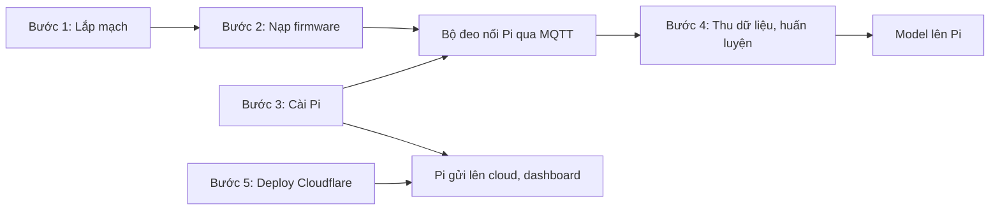

# Hướng dẫn cho thành viên nhóm

Bộ hướng dẫn làm lại toàn bộ hệ thống HAR từ đầu, theo đúng thứ tự nhóm đã làm. Mỗi file có phần **Sự cố đã gặp**: lỗi thật đã xảy ra, nguyên nhân và cách xử lý, để người sau không mất thời gian lần lại.

Trước khi đọc, xem bức tranh chung ở [`../kien-truc.md`](../kien-truc.md): bộ đeo ESP32 → Raspberry Pi 4 → Cloudflare, kèm Telegram.

| # | File | Nội dung | Cần gì |
| --- | --- | --- | --- |
| 1 | [01-lap-mach-va-hop-deo.md](01-lap-mach-va-hop-deo.md) | Linh kiện, thử breadboard, hàn, kiểm tra điện, xếp vào hộp, cách đeo | Linh kiện, mỏ hàn, đồng hồ vạn năng |
| 2 | [02-nap-firmware.md](02-nap-firmware.md) | Cài PlatformIO, điền `secrets.h`, nạp, kiểm tra Serial, test logic | Laptop, cáp USB dữ liệu |
| 3 | [03-cai-dat-pi.md](03-cai-dat-pi.md) | Cài Raspberry Pi OS, Mosquitto, chrony, tường lửa, 5 dịch vụ HAR, bot Telegram | Pi 4, thẻ nhớ ≥ 16 GB, Wi-Fi nhà |
| 4 | [04-du-lieu-huan-luyen-kiem-thu.md](04-du-lieu-huan-luyen-kiem-thu.md) | Thu dữ liệu, huấn luyện, đánh giá, đưa model lên Pi, các bộ test | Bộ đeo + Pi đang chạy, laptop Python |
| 5 | [05-deploy-cloudflare.md](05-deploy-cloudflare.md) | Tạo D1, deploy Worker + dashboard, bí mật, tài khoản, nối Pi lên cloud | Tài khoản Cloudflare, Node ≥ 18 |

Sau khi cài xong: [`../van-hanh.md`](../van-hanh.md) (việc hằng ngày, sự cố thường gặp khi đang chạy).

## Thứ tự và phụ thuộc

Bước 3 và bước 5 làm song song được với bước 1–2. Bước 4 cần bộ đeo và Pi đã nói chuyện được với nhau.

## Quy tắc chung của nhóm

- **Phần cứng là gốc.** Code và tài liệu theo mạch đang hàn, không theo bản thiết kế. Nhóm đã mất nhiều thời gian vì firmware viết theo thiết kế trong khi mạch hàn khác (chân nút, hướng MPU6050, OLED).
- **Không commit bí mật:** `firmware/include/secrets.h`, `edge/.env`, `cloud/.dev.vars` nằm trong `.gitignore`. Không dán mật khẩu, token, khóa thiết bị vào chat nhóm, issue hay PR.
- **Không commit dữ liệu thô.** Dataset ở Google Drive ([`../../ml/data/README.md`](../../ml/data/README.md)).
- **Mỗi việc một nhánh,** gộp vào `main` qua pull request.
- Thời gian trong dữ liệu là epoch mili giây UTC; mã thiết bị là `har01`.

## Thông số hệ thống đang chạy

| Thành phần | Giá trị |
| --- | --- |
| Bộ đeo | `har01`, firmware 1.0.0 |
| Pi | Tên `raspivn`, IP `192.168.12.19`, người dùng `pi`, code ở `~/har` |
| Wi-Fi | Mạng nhà 2,4 GHz, dải `192.168.12.0/24` (ESP32 không vào được 5 GHz) |
| Cloud | `https://har-cloud.har-cloud.workers.dev`, D1 `har-db` (APAC) |
| Telegram | `@harnoti_bot` |
| Repo | `github.com/huuvietnguyen72/har` |

Thông số này của nhóm hiện tại. Nếu dựng hệ thống mới ở mạng khác, thay IP, tên Wi-Fi, URL theo máy của mình.
