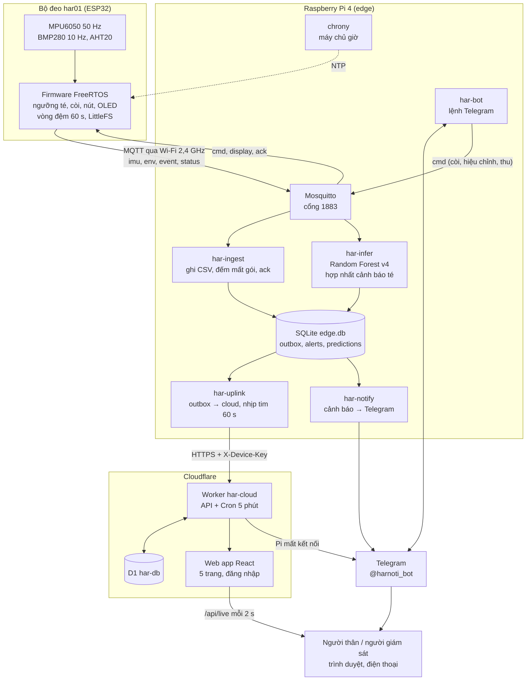
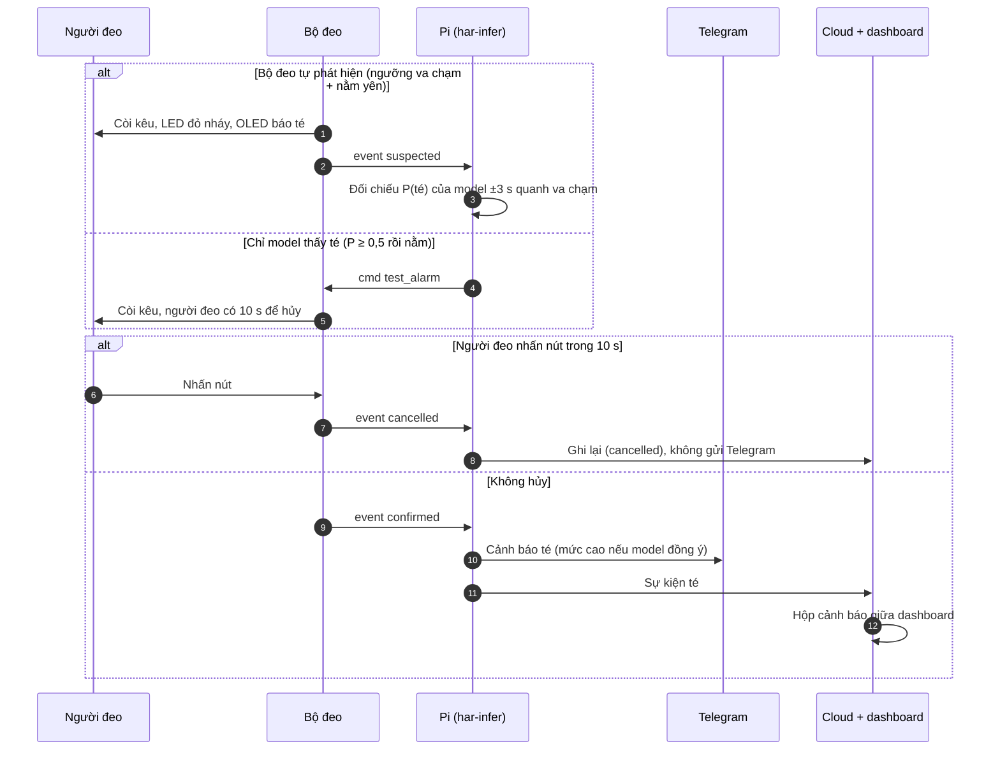

# Cấu trúc hệ thống

Hệ thống đang chạy thật, cập nhật 21/11/2026. Phần cứng bộ đeo: [`hardware/README.md`](../hardware/README.md). Hợp đồng dữ liệu: [`mqtt.md`](mqtt.md), [`api.md`](api.md), [`data-schema.md`](data-schema.md).

Hệ thống IoT cấp 2 theo Bahga & Madisetti ([lý do](#cấp-độ-iot)), gồm 3 tầng:

- **Bộ đeo** `har01`: đọc cảm biến, tự phát hiện té bằng ngưỡng, bật còi.
- **Raspberry Pi 4** (edge): thu dữ liệu, chạy model nhận dạng hoạt động, hợp nhất cảnh báo, gửi Telegram.
- **Cloudflare** (cloud): lưu kết quả và số liệu đánh giá, phục vụ dashboard có đăng nhập.

## Sơ đồ tổng thể

## Ba tầng

| Tầng | Thiết bị | Việc làm | Nối với tầng trên |
| --- | --- | --- | --- |
| Bộ đeo | ESP32 DevKit, MPU6050, AHT20 + BMP280, OLED 0,96", nút, 2 LED, loa, pin LiPo 1000 mAh ([`hardware/`](../hardware/README.md)) | Lấy mẫu 50 Hz. Phát hiện té bằng ngưỡng rồi kêu còi, cho người đeo 10 s tự hủy. Lưu sự kiện vào flash tới khi Pi xác nhận. Đệm 60 s dữ liệu khi mất mạng | MQTT trên Wi-Fi nhà, cùng mạng LAN với Pi |
| Edge | Raspberry Pi 4, Raspberry Pi OS 64-bit | Broker MQTT, máy chủ giờ, lưu dữ liệu thô 50 Hz, chạy model mỗi 1 s, hợp nhất cảnh báo té, Telegram, hàng đợi gửi cloud | HTTPS tới Cloudflare Worker, khóa thiết bị `X-Device-Key` |
| Cloud | Cloudflare Worker `har-cloud`, D1 `har-db` (APAC), assets web app | API ghi/đọc, lưu trạng thái, đoạn hoạt động, sự kiện, số liệu đánh giá; dashboard; Cron kiểm tra Pi mất kết nối | Trình duyệt (JWT), Telegram Bot API |

Dữ liệu thô 50 Hz chỉ nằm trên Pi (`~/har/edge/data/`) và trong dataset của nhóm. Cloud chỉ nhận kết quả đã xử lý: hoạt động hiện tại, các đoạn hoạt động, sự kiện, độ trễ, tỉ lệ mất gói và kết quả đánh giá model.

## Cấp độ IoT

**Cấp 2** theo Bahga & Madisetti: **một node** giám sát, **phân tích cục bộ**, **lưu trữ và ứng dụng trên cloud**. Node gồm bộ đeo và Pi: Pi là phần xử lý cục bộ của node (Controller Service và phân tích), không điều phối nhiều node.

| Thành phần cấp 2 | Trong HAR |
| --- | --- |
| Device | Bộ đeo `har01`: ESP32, MPU6050, AHT20 + BMP280, còi, LED, nút, OLED |
| Resource | Firmware: đọc cảm biến, gửi MQTT, điều khiển còi |
| Controller Service (cục bộ) | Dịch vụ trên Pi: `har-ingest`, `har-uplink` (gửi lên cloud qua HTTPS), `har-bot` (lệnh xuống bộ đeo) |
| Analysis (cục bộ) | `har-infer` trên Pi: model v4, hợp nhất cảnh báo té |
| Database (cloud) | D1 `har-db` |
| Web service (cloud) | Worker `har-cloud`: REST API `/api/*` |
| Application (cloud) | Dashboard trên Cloudflare; người thân nhận cảnh báo qua Telegram (bot `har-bot` chạy trên Pi, cảnh báo Pi mất kết nối do Cron trên cloud gửi) |

Không phải cấp khác vì:

- **Cấp 1:** lưu trữ và ứng dụng cục bộ. HAR lưu trên D1, xem qua Internet.
- **Cấp 3:** phân tích trên cloud. HAR phân tích ở Pi; cloud chỉ tổng hợp thống kê.
- **Cấp 4, 5, 6:** cần nhiều node. HAR có một bộ đeo.

Phân tích đặt cục bộ vì cảnh báo té cần độ trễ thấp và phải chạy khi mất Internet. Mỗi bộ đeo có mã `{dev}` riêng trong MQTT và API, nên thêm bộ đeo thì Pi trở thành node điều phối và hệ thống lên cấp 5 (hướng phát triển, chưa làm).

## Bộ đeo

Firmware ESP32 (Arduino, FreeRTOS), mã nguồn ở [`firmware/`](../firmware/):

| Task | Việc làm |
| --- | --- |
| Cảm biến | Đọc MPU6050 50 Hz (±8 g, ±500 °/s), BMP280 10 Hz, AHT20; gom gói 25 mẫu (0,5 s) |
| Phát hiện té | Ngưỡng va chạm, sau đó nằm yên → `suspected`, còi kêu 10 s → `confirmed` nếu không hủy |
| Mạng | Wi-Fi, MQTT, gửi bù dữ liệu từ vòng đệm 60 s khi có mạng lại; gửi lại sự kiện mỗi 5 s tới khi nhận `ack` |
| Giao diện | Nút (1 lần bật màn, 2 lần đánh dấu, 3 lần hiệu chỉnh hướng đứng, giữ 3 s SOS, nhấn khi đang báo động thì hủy), OLED, 2 LED, loa |
| Lệnh từ Pi | `test_alarm`, `cancel_alarm`, `beep`, `calibrate_upright`, `set_upright`, `display` |

Logic thuần C++ (nút, máy trạng thái cảnh báo, hiệu chỉnh, chọn mạng Wi-Fi) có 23 test chạy trên máy tính (`pio test -e native`).

## Pi (edge)

Mỗi dịch vụ là một unit systemd, tự chạy khi Pi khởi động. Chi tiết: [`edge/README.md`](../edge/README.md).

| Dịch vụ | Việc làm |
| --- | --- |
| Mosquitto | Broker MQTT cổng 1883, bắt buộc tài khoản, tường lửa chỉ mở cho mạng nội bộ |
| chrony | Máy chủ giờ cho ESP32, vẫn chạy khi mất Internet |
| `har-ingest` | Đổi đơn vị, đếm gói mất theo `seq`, ghi CSV liên tục và theo phiên thu, xác nhận sự kiện về bộ đeo (`har/{dev}/ack`) |
| `har-infer` | Cửa sổ 2,5 s trượt mỗi 1 s → model v4 (Random Forest, IMU + áp suất) → làm mượt → gộp đoạn. Hợp nhất cảnh báo té của bộ đeo với model; khi chỉ model thấy té thì gửi `test_alarm` để bộ đeo kêu còi. Gửi nhãn hiện tại lên OLED |
| `har-uplink` | Lấy bản ghi từ outbox SQLite gửi lên cloud, thử lại 2 → 60 s, ưu tiên sự kiện; nhịp tim mỗi 60 s |
| `har-notify` | Gửi cảnh báo qua Telegram, chống trùng, gộp cảnh báo cùng loại cách nhau dưới 20 s, ghi "gửi trễ" khi Telegram lỗi |
| `har-bot` | Lệnh Telegram `/trangthai`, `/homnay`, `/coi`, `/tatcoi`, `/hieuchinh`, `/thu`, `/dung`; nút dưới tin cảnh báo té |

Model nhận 7 hoạt động ([`labels.md`](labels.md)): đứng, ngồi, nằm, đi, lên cầu thang, xuống cầu thang, té. Huấn luyện ở [`ml/`](../ml/), chép sang `edge/models/current/`.

## Cloud

Mã nguồn ở [`cloud/`](../cloud/). Một Worker vừa phục vụ API, vừa phục vụ web app; dữ liệu nằm trong D1.

| Nhóm API | Ai gọi | Xác thực |
| --- | --- | --- |
| `POST /api/ingest/{status, heartbeat, segments, events, metrics, system_metrics}` | Pi | `X-Device-Key` (D1 chỉ lưu băm SHA-256) |
| `POST /api/auth/login`, `GET /api/auth/me` | Web app | Mật khẩu (PBKDF2) → JWT |
| `GET /api/{devices, status, live, status/history, segments, summary, events, metrics, system_metrics}`, xử lý cảnh báo | Web app | JWT |
| Cron `*/5 * * * *` | Cloudflare | Pi im quá 10 phút → Telegram "Pi mất kết nối", ghi sự kiện; Pi gửi lại → "đã kết nối lại" |

Web app ([`webapp/`](../webapp/)) có 5 trang: Tổng quan, Cảm biến (biểu đồ gia tốc, con quay, độ cao trực tiếp 2 phút và lịch sử 24 giờ), Lịch sử, Cảnh báo, Đánh giá model. Trang hỏi `/api/live` mỗi 2 s và ngừng khi tab ẩn. Khi có té, hộp cảnh báo hiện giữa màn hình kèm âm báo. Bản backend VPS (FastAPI + PostgreSQL, [`backend/`](../backend/)) dùng cùng API, giữ làm dự phòng.

## Luồng dữ liệu

| Chặng | Giao thức | Nội dung, tần suất | Đo trên hệ thống thật |
| --- | --- | --- | --- |
| Bộ đeo → Pi | MQTT QoS 0 | `imu` 25 mẫu/0,5 s, `env` 5 mẫu/0,5 s, `status` (retained, Last Will), `event` (gửi lại tới khi có `ack`) | Trễ trung vị 18 ms, p95 28 ms; mất gói 0–0,12 %/ngày |
| Pi → bộ đeo | MQTT QoS 1 | `cmd`, `display`, `ack` | |
| Trên Pi | | Model mỗi 1 s, cửa sổ 2,5 s | Mẫu cuối → kết quả: trung vị 71 ms; RF ~28 ms/cửa sổ |
| Pi → cloud | HTTPS, giữ kết nối 60 s | Trạng thái mỗi 5 s (đổi hoạt động thì gửi ngay), đoạn hoạt động, sự kiện, số liệu hệ thống, nhịp tim 60 s | Trung vị ~0,6 s, chậm nhất 1,9 s |
| Cloud → trình duyệt | HTTPS, hỏi định kỳ | `/api/live` mỗi 2 s | Dashboard đổi ~2 s sau khi Pi gửi |
| Pi → Telegram | HTTPS long polling | Cảnh báo, trả lời lệnh | Té → Telegram ~13 s (bộ đeo phát hiện), ~19 s (chỉ model), đã gồm 10 s chờ hủy |

Pi và cloud đều chống trùng theo `id` sự kiện, nên gửi lại bao nhiêu lần cũng không sinh bản ghi thừa. Mất Internet: dữ liệu nằm trong outbox trên Pi, gửi bù khi có mạng lại.

## Luồng cảnh báo té

Bộ đeo không phản hồi trong 15 s (mất kết nối, hết pin): Pi vẫn báo Telegram (`reason = device_no_response`) nhưng không bật được còi. Bảng quy tắc đầy đủ: [`edge/README.md`](../edge/README.md#quy-tắc-hợp-nhất-cảnh-báo-té).

## Cảnh báo kỹ thuật

| Sự cố | Ai phát hiện | Khi nào |
| --- | --- | --- |
| Bộ đeo mất kết nối (tắt, hết pin, ra khỏi vùng Wi-Fi) | Pi (Last Will của MQTT, hết dữ liệu) | Sau 2 phút |
| Pi mất kết nối (tắt, mất điện, mất Internet) | Cloud (Cron, nhịp tim 60 s) | Sau 10–15 phút; báo lại khi Pi kết nối lại |
| Lỗi MPU6050 | Bộ đeo: LED đỏ sáng liên tục (Pi không báo riêng) | Ngay |
| Pin yếu | Chưa có: mạch không đo áp pin (`battery_v: null`) | |

## Bảo mật

- MQTT bắt buộc tài khoản; tường lửa Pi chỉ mở cổng 1883 cho mạng nội bộ.
- Pi gọi cloud qua HTTPS bằng khóa thiết bị riêng; D1 chỉ lưu băm của khóa. Đổi khóa: `node cloud/scripts/admin.mjs rotate-key`.
- Dashboard bắt đăng nhập, không có trang tự đăng ký; mật khẩu băm PBKDF2, phiên đăng nhập bằng JWT.
- Bot Telegram chỉ nhận lệnh từ chat trong `TELEGRAM_CHAT_ID` / `TELEGRAM_ALLOWED_IDS`; log không ghi token.
- Bí mật nằm trong `firmware/include/secrets.h`, `edge/.env`, bí mật của Worker (`wrangler secret`), không có trong repo.

## Cấu trúc repo

| Thư mục | Tầng |
| --- | --- |
| [`hardware/`](../hardware/) | Bộ đeo: sơ đồ mạch, cấu trúc hộp, datasheet |
| [`firmware/`](../firmware/) | Bộ đeo: firmware ESP32 (PlatformIO) |
| [`edge/`](../edge/) | Pi: các dịch vụ, `record.py`, systemd, script cài đặt |
| [`ml/`](../ml/) | Dataset, huấn luyện, thí nghiệm, kết quả đánh giá |
| [`cloud/`](../cloud/) | Cloud đang dùng: Cloudflare Worker + D1 |
| [`webapp/`](../webapp/) | Dashboard React (deploy cùng Worker) |
| [`backend/`](../backend/) | Bản VPS dự phòng |
| [`docs/`](.) | Hợp đồng dữ liệu, kế hoạch, vận hành |
