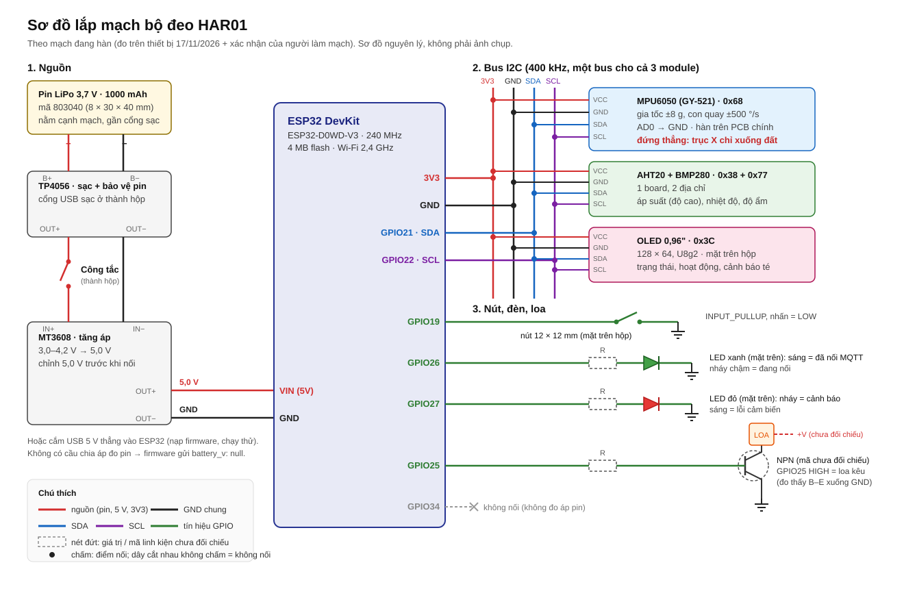
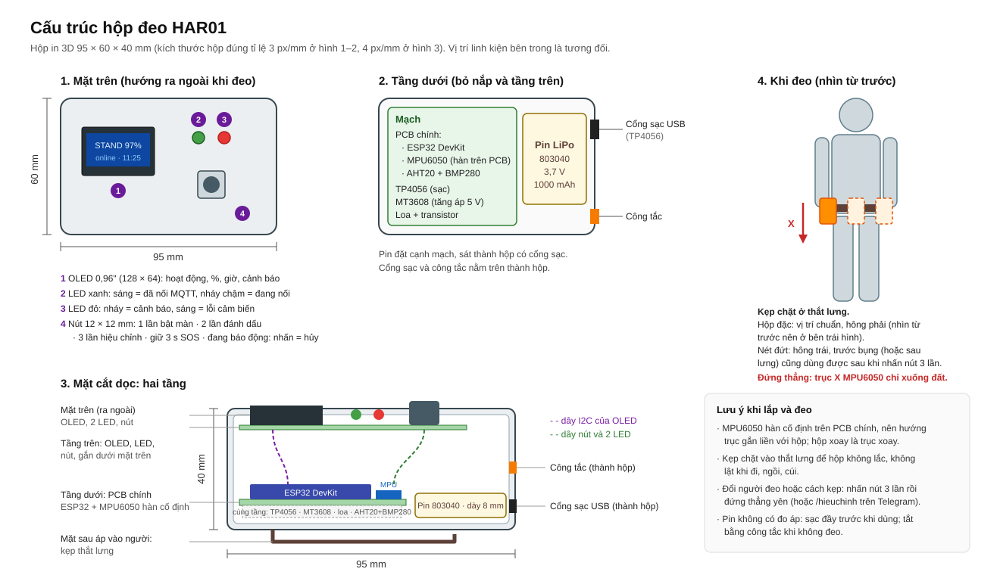

# Phần cứng bộ đeo HAR01

Theo mạch và hộp đang dùng: đo trên thiết bị ngày 17/11/2026 (quét I2C, đọc ID chip, đo tải từng chân) và xác nhận của người làm mạch ngày 21/11/2026. Cấu trúc toàn hệ thống: [`docs/kien-truc.md`](../docs/kien-truc.md). Bảng chân cho firmware: [`docs/pinout.md`](../docs/pinout.md).

| File | Nội dung |
| --- | --- |
| [`so-do-mach.svg`](so-do-mach.svg) | Sơ đồ lắp mạch như đang hàn |
| [`hop-deo.svg`](hop-deo.svg) | Cấu trúc hộp đeo: mặt trên, tầng dưới, mặt cắt, vị trí đeo |
| [`Datasheet_HAR01.html`](Datasheet_HAR01.html) | Số đo trên thiết bị: ID chip I2C, đo từng chân, bộ nhớ flash, trạng thái lúc đọc |
| [`So_do_lap_bo_deo_HAR.html`](So_do_lap_bo_deo_HAR.html) | Bản thiết kế ban đầu (hướng dẫn hàn, breadboard). **Khác mạch thật** ở chân GPIO, hộp và nguồn; xem mục [Khác bản thiết kế ban đầu](#khác-bản-thiết-kế-ban-đầu) |

## Linh kiện

| Linh kiện | SL | Vai trò |
| --- | --- | --- |
| ESP32 DevKit (ESP32-D0WD-V3, flash 4 MB, USB CP210x) | 1 | Vi điều khiển, Wi-Fi 2,4 GHz |
| MPU6050 (GY-521) | 1 | Gia tốc kế + con quay 6 trục, I2C 0x68; hàn trên PCB chính |
| Board AHT20 + BMP280 | 1 | Áp suất (đổi ra độ cao, phân biệt cầu thang), nhiệt độ, độ ẩm; I2C 0x38 + 0x77 |
| OLED 0,96" 128 × 64 | 1 | Màn hình trạng thái, I2C 0x3C |
| Nút nhấn 12 × 12 mm | 1 | Hủy cảnh báo, SOS, hiệu chỉnh, bật màn |
| LED xanh, LED đỏ + điện trở | 2 | Trạng thái kết nối, cảnh báo |
| Loa (còi) + transistor NPN + điện trở | 1 | Còi báo té |
| Pin LiPo 3,7 V 1000 mAh, mã 803040 (8 × 30 × 40 mm) | 1 | Nguồn khi đeo |
| TP4056 | 1 | Sạc và bảo vệ pin, cổng USB ra thành hộp |
| Công tắc | 1 | Bật/tắt nguồn pin, ở thành hộp |
| MT3608 | 1 | Tăng áp pin lên 5,0 V cho chân VIN của ESP32 |
| Hộp in 3D 95 × 60 × 40 mm, kẹp thắt lưng | 1 | Vỏ, gắn vào thắt lưng |

Giá trị điện trở, mã transistor loa và cực nối của loa chưa đối chiếu trên mạch, nên sơ đồ vẽ nét đứt.

## Sơ đồ lắp mạch

### Nối dây

| Từ | Đến | Ghi chú |
| --- | --- | --- |
| Pin + / − | TP4056 B+ / B− | |
| TP4056 OUT+ | Công tắc → MT3608 IN+ | Lấy nguồn ở OUT để đi qua mạch bảo vệ của TP4056 |
| TP4056 OUT− | MT3608 IN− | |
| MT3608 OUT+ / OUT− | ESP32 VIN (5V) / GND | Chỉnh MT3608 đúng 5,0 V **trước** khi nối ESP32 |
| ESP32 3V3, GND | VCC, GND của MPU6050, AHT20 + BMP280, OLED | Cả 3 module chạy 3,3 V |
| ESP32 GPIO21 (SDA), GPIO22 (SCL) | SDA, SCL của cả 3 module | Một bus I2C, 400 kHz, quét ra 4 địa chỉ: 0x38, 0x3C, 0x68, 0x77 |
| MPU6050 AD0 | GND | Giữ địa chỉ 0x68 |
| GPIO19 | Nút → GND | `INPUT_PULLUP`, nhấn = LOW |
| GPIO26 | Điện trở → LED xanh → GND | HIGH = sáng |
| GPIO27 | Điện trở → LED đỏ → GND | HIGH = sáng |
| GPIO25 | Điện trở → chân B transistor NPN; E → GND; C → loa | HIGH = loa kêu (`BUZZER_PASSIVE 0`) |
| GPIO34 | Không nối | Không có cầu chia áp: firmware gửi `battery_v: null` |

Có thể cắm USB 5 V thẳng vào ESP32 để nạp firmware và chạy thử, không cần bật công tắc pin.

## Cấu trúc hộp đeo

| Phần | Bố trí |
| --- | --- |
| Hộp | In 3D, 95 × 60 × 40 mm, hai tầng |
| Mặt trên (hướng ra ngoài) | OLED, LED xanh, LED đỏ, nút |
| Tầng dưới | PCB chính có ESP32 và MPU6050 hàn cố định; board AHT20 + BMP280, TP4056, MT3608, loa |
| Pin | Đặt cạnh mạch, sát thành hộp có cổng sạc |
| Thành hộp | Cổng sạc USB của TP4056, công tắc nguồn |
| Mặt sau (áp vào người) | Kẹp thắt lưng |

### Vị trí đeo

- Kẹp **chặt** vào thắt lưng. Vị trí chuẩn: **hông phải** (phần lớn dữ liệu huấn luyện thu ở đây). Hông trái, trước bụng hoặc sau lưng cũng dùng được sau khi hiệu chỉnh hướng đứng (nhấn nút 3 lần): model v4 đạt 95 % trên dữ liệu thử ở 4 cách đeo khác. Không đeo ở cổ tay, trong túi hoặc kẹp lỏng.
- Đứng thẳng thì **trục X của MPU6050 chỉ xuống đất** (ax ≈ −1 g). Firmware gửi giá trị thô theo trục chip; Pi xoay tín hiệu về hướng đứng theo kết quả hiệu chỉnh, nên đeo lệch một chút vẫn nhận đúng.
- MPU6050 hàn cố định trên PCB, nên hướng trục gắn liền với hộp. Kẹp chặt để hộp không lắc hay lật.
- Đổi người đeo hoặc cách kẹp: nhấn nút 3 lần rồi đứng thẳng yên ~2 s (bíp dài = đạt), hoặc gõ `/hieuchinh` trên Telegram.
- Bật bộ đeo rồi đặt yên ~2 s để con quay tự hiệu chỉnh, sau đó mới đeo.

### Nút, đèn, loa

| Thao tác / tín hiệu | Ý nghĩa |
| --- | --- |
| Nhấn 1 lần | Bật màn hình |
| Nhấn đúp | Đánh dấu (`marker`) |
| Nhấn 3 lần | Hiệu chỉnh hướng đứng |
| Giữ 3 s | SOS |
| Nhấn khi đang báo động | Trong 10 s chờ: hủy cảnh báo té. Sau khi té đã xác nhận: tắt còi, báo người thân "người đeo đã bấm nút" (cảnh báo vẫn chưa xử lý) |
| LED xanh sáng / nháy chậm | Đã nối MQTT / đang nối |
| LED đỏ nháy nhanh / sáng | Đang báo động / lỗi MPU6050 |
| Còi ngắt quãng → liên tục | Nghi té, chờ hủy 10 s → đã xác nhận té (kêu 30 s) |

## Khác bản thiết kế ban đầu

[`So_do_lap_bo_deo_HAR.html`](So_do_lap_bo_deo_HAR.html) là bản thiết kế trước khi hàn. Mạch và hộp thật khác ở:

| Mục | Bản thiết kế | Thật |
| --- | --- | --- |
| Pin | 18650 | LiPo 803040, 1000 mAh |
| Hộp | Mua sẵn 100 × 68 × 50 mm | In 3D 95 × 60 × 40 mm, kẹp thắt lưng |
| MPU6050 | Bắt vít vào đáy hộp, trục Y chỉ xuống | Hàn trên PCB chính, **trục X chỉ xuống** |
| Nút | GPIO32 | GPIO19 |
| OLED | Không có | Có, chung bus I2C |
| Đo áp pin | Cầu chia 100 kΩ / 100 kΩ vào GPIO34 | Không có |
| Motor rung | Tùy chọn, GPIO33 | Không có (`USE_VIBRATION 0`) |

## Hạn chế

- Không đo được áp pin: không có % pin, không có cảnh báo pin yếu. Thời lượng pin chưa đo; sạc đầy trước khi dùng.
- Không có motor rung, chỉ có còi và LED.
- Chưa đo dòng tiêu thụ.

## Nên bổ sung

- Đo thời lượng pin (sạc đầy, chạy tới khi tắt) và dòng tiêu thụ bằng USB tester.
- Ghi mã các linh kiện chưa đối chiếu: transistor loa, điện trở LED và điện trở chân B.
- Cầu chia áp vào GPIO34 nếu làm bản mạch sau (firmware đã sẵn sàng đọc).
